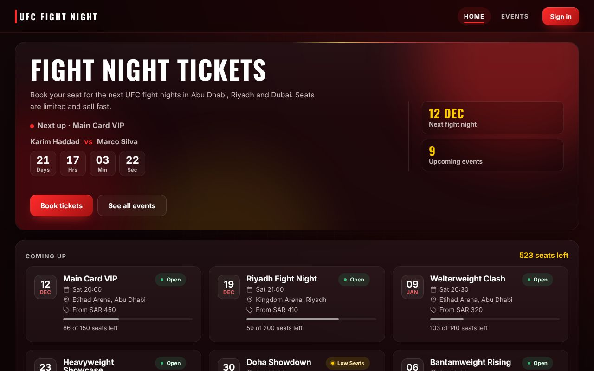
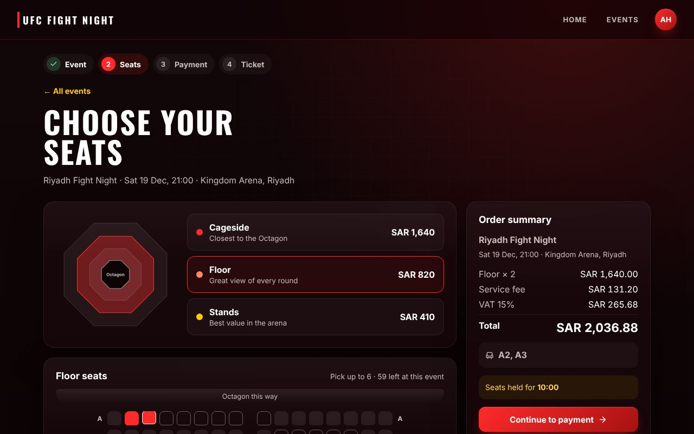
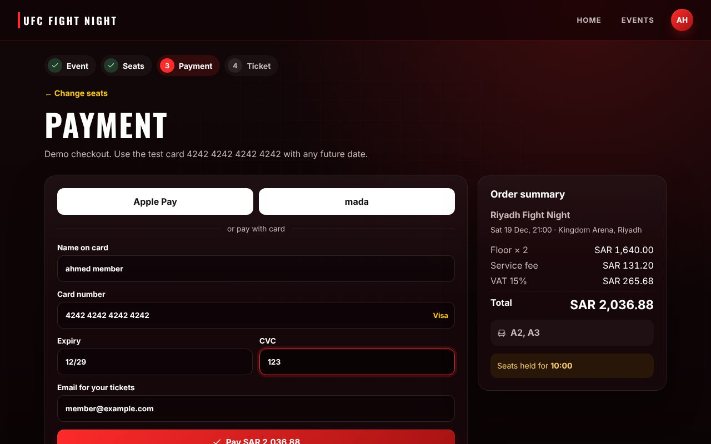
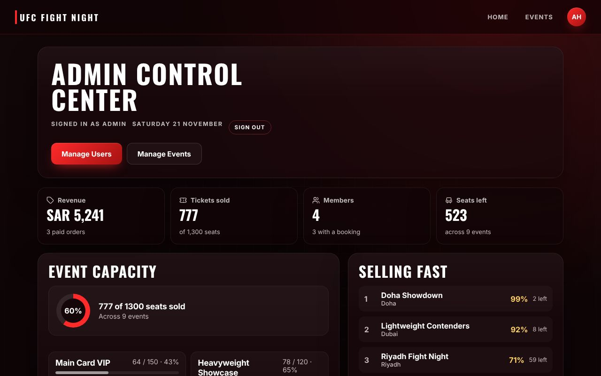
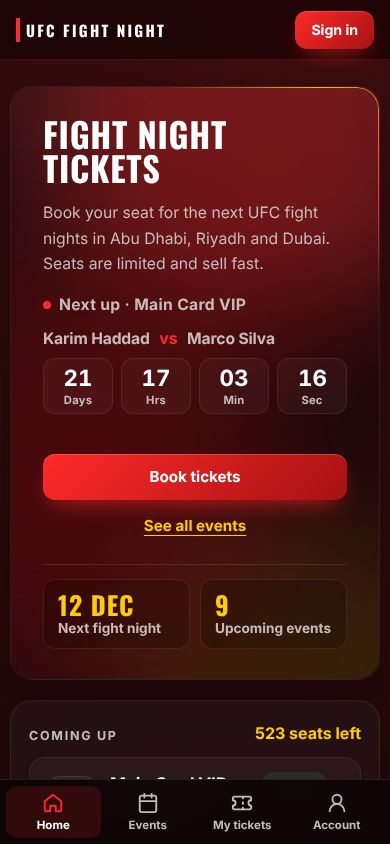

# UFC Fight Night — Event Ticketing System

A full-stack ticket booking system for UFC fight nights, with separate **member** and **admin** roles.
The production app is built with **PHP 8 and MySQL**. An **interactive preview** of the complete booking journey is published on GitHub Pages.

[](https://github.com/AAAprog/ufc-event-system/actions/workflows/preview-tests.yml)

**[Live demo →](https://aaaprog.github.io/ufc-event-system/)**



| Seat selection | Payment |
| --- | --- |
|  |  |

| Admin dashboard | Phone |
| --- | --- |
|  |  |

---

## Highlights

- **No overbooking.** Bookings run inside MySQL transactions with row-level locking (`SELECT … FOR UPDATE`) and an atomic capacity check, so two people can never take the last seat.
- **Secure by default.** Passwords are hashed with `password_hash()`. Every state-changing form carries a CSRF token. The session is regenerated on login, and all user input goes through prepared statements.
- **Two roles.** Members register, sign in, book and switch events, and manage their profile. Admins manage events, capacity and member accounts.
- **Full booking journey in the preview.** Event search and city filters, a seat map with a 10-minute hold, an order summary with fees and VAT in SAR, a validated card checkout, a QR ticket, and an admin dashboard with revenue and capacity.
- **Tested.** 37 automated browser checks run on every push and pull request.

## Two parts of this repository

| | PHP application | Interactive preview |
| --- | --- | --- |
| Location | repository root (`admin/`, `user/`, `db/`) | `docs/` |
| Runs on | Apache + PHP 8 + MySQL | any browser, hosted on GitHub Pages |
| Data | MySQL database | each visitor's browser (`localStorage`) |
| Purpose | the real system | a portfolio demo you can click through |

The preview simulates payment and taken seats. Each visitor's changes stay in their own browser.

## Features

### Members
- Register, sign in and update profile (optional password change)
- Browse fight nights; search and filter by city
- Choose a section (Cageside, Floor, Stands) and exact seats, up to 6 per booking *(preview)*
- Checkout with service fee and 15% VAT, card validation and a seat-hold timer *(preview)*
- Book, switch or cancel a booking; seats are released automatically

### Admins
- Separate sign-in with a session guard and sign-out
- Dashboard: revenue, tickets sold, members, seats left, best-selling events and recent bookings
- Manage events: create with date, venue, city, capacity and price; edit inline; delete
- Manage members: search, view bookings and payments, delete accounts (their seats are released)

## Tech stack

| Area | Technology |
| --- | --- |
| Backend | PHP 8, MySQLi prepared statements, sessions |
| Database | MySQL / MariaDB |
| Frontend | HTML, CSS, vanilla JavaScript |
| Testing | Playwright (end-to-end browser tests) |
| CI / hosting | GitHub Actions, GitHub Pages |

## Project structure

```text
.
├── admin/                  Admin sign-in, dashboard, manage events, manage users
├── user/                   Member registration, sign-in, profile, dashboard, booking
├── db/
│   ├── app.php             Shared helpers: sessions, CSRF, validation, escaping
│   ├── config.php          Database connection (reads runtime file or env vars)
│   ├── config.runtime.example.php
│   └── setup.sql           Schema and seed data
├── css/                    Styles for the PHP application
├── index.php               Landing page
├── docs/                   Interactive preview (GitHub Pages)
│   ├── index.html
│   └── assets/
│       ├── css/            Base styles + modern, inspire and tidy layers
│       └── js/             App logic, checkout, admin, home/auth, UI layers
├── tests/
│   └── preview.e2e.js      37 end-to-end checks for the preview
├── scripts/
│   ├── screenshots.js      Regenerates the README screenshots
│   └── sync-to-xampp.ps1   Mirrors the project into XAMPP
├── guides/
│   └── DEPLOYMENT.md       Deploying to a PHP/MySQL host
└── .github/
    ├── workflows/          CI: runs the preview tests
    └── assets/             README screenshots
```

## Run the PHP app locally

**Requirements:** PHP 8+, MySQL or MariaDB, and Apache (XAMPP works).

1. **Create the database.** Create a database named `ufc_event` and import [`db/setup.sql`](db/setup.sql).
2. **Configure the connection.** XAMPP defaults (`localhost`, `root`, empty password, `ufc_event`) work out of the box. For other setups, copy `db/config.runtime.example.php` to `db/config.runtime.php` and fill in your values; this file is git-ignored. Environment variables `DB_HOST`, `DB_USER`, `DB_PASS` and `DB_NAME` also work.
3. **Serve it.** Put the project in your web root, for example `C:\xampp\htdocs\ufc_event_system`. On Windows, `scripts/sync-to-xampp.ps1` does this for you. Then open `http://localhost/ufc_event_system/`.

The schema seeds an `admin` account. Replace its password hash in `db/setup.sql` with one you generate before deploying anywhere public.

To deploy to a shared PHP host, see [`guides/DEPLOYMENT.md`](guides/DEPLOYMENT.md).

## Run the preview and tests

The preview needs no build: open `docs/index.html` in a browser.

```bash
npm install
npx playwright install chromium
npm test                      # 37 end-to-end checks
node scripts/screenshots.js   # refresh README screenshots
```

**Demo logins:**
- Member: `ahmed_member` / `member123`
- Admin: open *Staff sign-in* in the footer, then `admin` / `admin123`
- Test card: `4242 4242 4242 4242`, any future expiry, any 3-digit CVC

## Security notes

- Credentials belong in `db/config.runtime.php` or environment variables, never in the repository.
- `.htaccess` turns off directory listing, adds security headers, and blocks SQL, config and repository-tooling files.
- The preview's demo credentials are public by design. They exist only in the browser demo, not in the PHP app.
